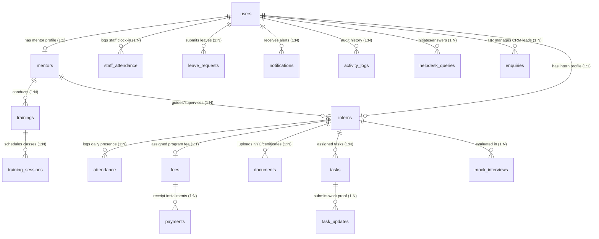

# IICET IMS - Complete Normalized Database Architecture & Guide

This document provides a comprehensive specification of the relational schema for the **IICET IMS (Internship & Talent Management System)**. The schema is engineered to **3rd Normal Form (3NF / BCNF)** to eliminate data redundancy, prevent update/delete anomalies, and enforce strict referential integrity across all system modules.

---

## 1. Database Normalization Analysis

### First Normal Form (1NF)
* Every column stores **atomic (indivisible) values**. Multi-valued columns (e.g. attendance records, payments, documents) are decoupled into distinct child tables.
* Every entity possesses a **unique primary key** (`id`).
* Column data types (e.g., `VARCHAR`, `DECIMAL`, `DATE`, `DATETIME`, `ENUM`) are strictly typed without mixed formatting.

### Second Normal Form (2NF)
* Meets all 1NF rules.
* **No Partial Dependencies**: Every non-prime attribute depends completely on the primary key.
* Compound relationships (such as unique attendance per intern per day) use composite unique constraints `UNIQUE(intern_id, date)` while retaining a surrogate key `id` for relational mapping.

### Third Normal Form (3NF & BCNF)
* Meets all 2NF rules.
* **No Transitive Dependencies**: Non-key attributes do not depend on other non-key attributes.
* **Role-Based Entity Specialization**: Core authentication and identity attributes reside solely in `users`. Role-specific attributes reside in specialized 1:1 extension tables (`mentors`, `interns`) referencing `users(id)` via Foreign Keys with `ON DELETE CASCADE`.
* **Financial Integrity**: Payment installments are stored in the `payments` ledger table, referencing `fees(id)`. This prevents redundant storage of financial calculations.
* **Master System Settings**: Organization details (GSTIN, CIN, address) are isolated in a singleton `company_profile` entity instead of duplicated across invoices or user records.

---

## 2. Complete Entity-Relationship (ER) Schema



---

## 3. Data Dictionary: Tables & Normalized Attributes

### 1. `users` (Central Identity & Authentication)
| Column | Type | Constraints | Description |
|---|---|---|---|
| `id` | INT | PK, AUTO_INCREMENT | Unique user identifier |
| `name` | VARCHAR(255) | NOT NULL | Full name of the user |
| `email` | VARCHAR(255) | NOT NULL, UNIQUE | Primary login email |
| `role` | ENUM | NOT NULL | `'Director'`, `'HR'`, `'Mentor'`, `'Intern'` |
| `status` | ENUM | NOT NULL, DEFAULT `'Active'` | `'Active'`, `'Inactive'` |
| `password_hash` | VARCHAR(255) | | Bcrypt hashed login credential |
| `plain_password` | VARCHAR(255) | | Administrative recovery password |
| `profile_photo` | VARCHAR(500) | | Uploaded photo file path |
| `department` | VARCHAR(255) | | Staff department |
| `designation` | VARCHAR(255) | | Job title / designation |
| `joining_date` | DATE | | Date joined organization |
| `mobile_number` | VARCHAR(50) | | Contact phone number |
| `is_online` | TINYINT(1) | DEFAULT 0 | Real-time presence flag |
| `last_active_at` | DATETIME | | Timestamp of last user activity |
| `created_at` | DATETIME | DEFAULT CURRENT_TIMESTAMP | Record creation timestamp |
| `updated_at` | DATETIME | DEFAULT CURRENT_TIMESTAMP | Automatic update timestamp |

### 2. `mentors` (Trainer Extension Profile)
| Column | Type | Constraints | Description |
|---|---|---|---|
| `id` | INT | PK, AUTO_INCREMENT | Unique mentor identifier |
| `user_id` | INT | UNIQUE, FK `users(id)` CASCADE | 1:1 link to user record |
| `department` | VARCHAR(255) | | Assigned trainer department |
| `technology` | VARCHAR(255) | NOT NULL | Primary expertise (Python, MERN, Java, etc.) |
| `performance_rating` | FLOAT | DEFAULT 5.0 | Trainer rating score (0.0 - 5.0) |
| `performance_notes` | TEXT | | Administrative assessment remarks |
| `hr_id` | INT | FK `users(id)` SET NULL | Assigned HR manager |

### 3. `interns` (Intern Extension Profile)
| Column | Type | Constraints | Description |
|---|---|---|---|
| `id` | INT | PK, AUTO_INCREMENT | Unique intern profile ID |
| `user_id` | INT | UNIQUE, FK `users(id)` CASCADE | 1:1 link to user account |
| `batch` | VARCHAR(100) | NOT NULL | Cohort batch code |
| `training_time` | VARCHAR(100) | DEFAULT `'09:00 AM - 01:00 PM'` | Daily batch timing |
| `mentor_id` | INT | FK `users(id)` SET NULL | Assigned mentor |
| `hr_id` | INT | FK `users(id)` SET NULL | Assigned HR coordinator |
| `department` | VARCHAR(255) | NOT NULL | Department stream |
| `technology` | VARCHAR(255) | NOT NULL | Training technology track |
| `status` | ENUM | NOT NULL, DEFAULT `'Active'` | `'Active'`, `'Completed'`, `'Terminated'` |
| `joining_date` | DATE | NOT NULL | Program start date |
| `completion_date` | DATE | | Program completion date |
| `duration_months` | INT | DEFAULT 6 | Program length in months |
| `mobile_number` | VARCHAR(50) | | Direct mobile number |
| `dob` | DATE | | Date of birth |
| `college_name` | VARCHAR(255) | | University / College institution |
| `qualifications` | VARCHAR(255) | | Academic degree (e.g. B.Tech, MCA, BCA) |
| `linkedin_url` | VARCHAR(500) | | LinkedIn profile URL |
| `github_url` | VARCHAR(500) | | GitHub portfolio URL |
| `resume_url` | VARCHAR(500) | | Resume document path |

### 4. `attendance` (Intern Daily Attendance)
| Column | Type | Constraints | Description |
|---|---|---|---|
| `id` | INT | PK, AUTO_INCREMENT | Record ID |
| `intern_id` | INT | NOT NULL, FK `interns(id)` CASCADE | Intern reference |
| `date` | DATE | NOT NULL | Attendance date |
| `check_in_time` | VARCHAR(50) | | Clock-in time |
| `check_out_time` | VARCHAR(50) | | Clock-out time |
| `working_hours` | FLOAT | DEFAULT 0 | Calculated session hours |
| `status` | ENUM | NOT NULL, DEFAULT `'Present'` | `'Present'`, `'Absent'`, `'Leave'`, `'Late'`, `'Half Day'` |
| `approved_by` | INT | FK `users(id)` SET NULL | Approving Mentor / HR ID |
| `comments` | TEXT | | Exceptions / attendance notes |
| *Constraint* | UNIQUE | `(intern_id, date)` | Enforces exactly 1 record per intern per day |

### 5. `staff_attendance` (Mentors & HR Staff Daily Clock-In)
| Column | Type | Constraints | Description |
|---|---|---|---|
| `id` | INT | PK, AUTO_INCREMENT | Record ID |
| `staff_id` | INT | NOT NULL, FK `users(id)` CASCADE | Staff user reference |
| `date` | DATE | NOT NULL | Attendance date |
| `check_in_time` | VARCHAR(50) | | Clock-in time |
| `check_out_time` | VARCHAR(50) | | Clock-out time |
| `working_hours` | FLOAT | DEFAULT 0 | Calculated working hours |
| `status` | ENUM | NOT NULL, DEFAULT `'Present'` | `'Present'`, `'Absent'`, `'Leave'`, `'Late'`, `'Half Day'` |
| `approved_by` | INT | FK `users(id)` SET NULL | Approving Director ID |
| `comments` | TEXT | | Note |
| *Constraint* | UNIQUE | `(staff_id, date)` | Enforces exactly 1 record per staff member per day |

### 6. `trainings` & `training_sessions` (Curriculum & Classes)
* **`trainings`**: Master modules with `title`, `description`, `department`, `technology`, `start_date`, `end_date`, `mentor_id`.
* **`training_sessions`**: Scheduled class meetings with `training_id`, `trainer_id`, `topic`, `date`, `time`, `duration`, `meeting_link`, `materials_link`.

### 7. `tasks` & `task_updates` (Assignments & Work Proof)
* **`tasks`**: Project tasks created with `title`, `description`, `assigned_to` (intern), `assigned_mentor_id`, `assigned_by`, `priority`, `due_date`, `status` (`'Pending'`, `'In Progress'`, `'Review'`, `'Completed'`).
* **`task_updates`**: Submissions by interns with `task_id`, `update_description`, `submission_link`, `submission_date`, `feedback`, `reviewed_by`, `reviewed_at`.

### 8. `fees` & `payments` (Financial Tracking Ledger)
* **`fees`**: Master financial obligation per intern (`intern_id` UNIQUE), with `total_amount`, `paid_amount`, `remaining_amount`, `due_date`, `status` (`'Fully Paid'`, `'Partially Paid'`, `'Unpaid'`).
* **`payments`**: Individual transactions with `fee_id`, `amount_paid`, `payment_date`, `payment_mode` (`'Cash'`, `'Bank Transfer'`, `'UPI'`, `'Card'`), `receipt_number` (UNIQUE), `comments`.

### 9. `documents` (KYC & Academic Records)
* Attributes: `intern_id`, `doc_type` (`'Resume'`, `'ID Proof'`, `'Offer Letter'`, `'Completion Certificate'`), `file_path`, `status` (`'Uploaded'`, `'Approved'`, `'Rejected'`), `verified_by`, `verified_at`.

### 10. `enquiries` (CRM Student Leads)
* Attributes: `name`, `phone`, `email`, `interest` (`'Software Development'`, `'Data Science'`), `status` (`'New'`, `'Callback'`, `'Enrolled'`, `'Rejected'`), `notes`, `last_follow_up_date`, `next_follow_up_date`, `hr_id`.

### 11. `helpdesk_queries` (Support & Doubts)
* Attributes: `user_id` (submitter), `target_user_id`, `target_role`, `category`, `priority`, `subject`, `query_text`, `answer_text`, `status` (`'Open'`, `'In Progress'`, `'Resolved'`, `'Closed'`), `solved_by`.

### 12. `mock_interviews` (Technical & HR Assessments)
* Attributes: `intern_id`, `mentor_id`, `type` (`'Mock Interview'`, `'Mock Test'`), `interviewer_name`, `scheduled_at`, `focus_areas`, `score` (0-10), `feedback`, `status`.

### 13. `leave_requests` (Time-Off Tracking)
* Attributes: `user_id`, `leave_type` (`'Casual'`, `'Sick'`, `'Emergency'`, `'Work From Home'`, `'Other'`), `start_date`, `end_date`, `total_days`, `reason`, `status` (`'Pending'`, `'Approved'`, `'Rejected'`, `'Cancelled'`), `reviewed_by`.

### 14. `company_profile` (Master Organization Identity)
* Singleton record (`id = 1`): `name`, `address`, `email`, `phone`, `website`, `gstin`, `cin`, `pan`, `director_name`, `logo_url`, `about`.

### 15. `notifications` & `activity_logs`
* System event broadcasting and audit security trail.

---

## 4. How to View and Manage the Database

### Option A: Viewing MySQL (`iicet_ims`)

MySQL is installed and running as a Windows Service (`MySQL80`) on port `3306`.

#### Connection Details:
* **Host:** `localhost` (or `127.0.0.1`)
* **Port:** `3306`
* **Username:** `root`
* **Password:** `root`
* **Database Name:** `iicet_ims`

#### Tools to View MySQL:
1. **MySQL Workbench / DBeaver / HeidiSQL / Navicat:**
   * Open your tool -> Click **New Connection**.
   * Enter Host: `localhost`, Port: `3306`, User: `root`, Password: `root`.
   * Under schemas/databases, double-click **`iicet_ims`** to view and query all tables.
2. **Command Prompt / PowerShell (CLI):**
   ```powershell
   mysql -u root -p
   # Enter password: root
   USE iicet_ims;
   SHOW TABLES;
   SELECT * FROM users;
   SELECT * FROM interns;
   SELECT * FROM fees;
   ```

---

### Option B: Viewing SQLite (`database/interns.db`)

The application's active SQLite database is stored locally at:
`NooralWorks\database\interns.db`

#### Tools to View SQLite:
1. **VS Code SQLite Viewer:**
   * Install the "SQLite Viewer" extension in VS Code.
   * In the file explorer, click on `database/interns.db` directly to open an interactive data table viewer.
2. **DB Browser for SQLite:**
   * Download and launch DB Browser for SQLite (free GUI).
   * File -> **Open Database** -> select `NooralWorks\database\interns.db`.
   * Navigate to the **Browse Data** tab to view tables.
3. **Node / Python quick inspection script:**
   ```powershell
   node -e "const { DatabaseSync } = require('node:sqlite'); const db = new DatabaseSync('./database/interns.db', { readOnly: true }); console.log(db.prepare('SELECT * FROM users').all());"
   ```

---

## 5. Synchronizing and Storing Each Entity in the Database

To ensure all system entities are stored and synchronized from the running SQLite database directly into MySQL:

```powershell
cd backend
node migrate-sqlite-to-mysql.js
```
This utility:
1. Automatically verifies tables against 3NF rules.
2. Applies Foreign Key cascades and index optimizations.
3. Transfers all active records across all 19 entities without data loss.
