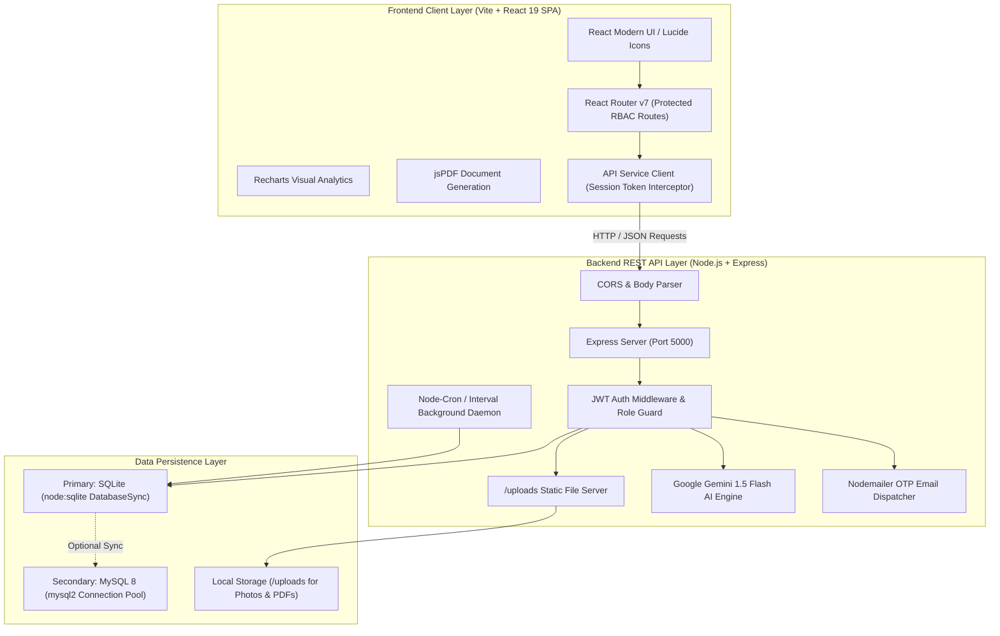
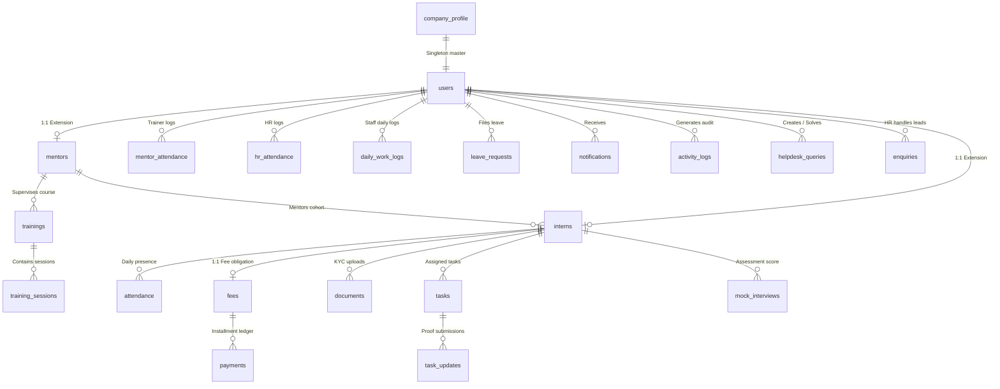
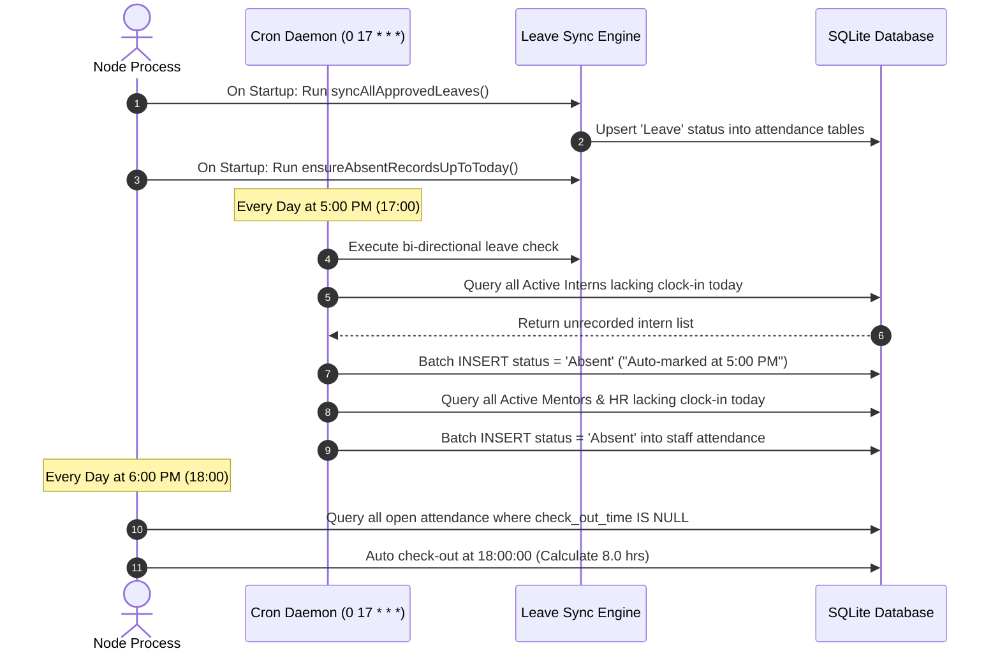

# IICET IMS — Institutional Internship & Talent Management System
> **Unified Enterprise Platform for Intern Onboarding, Attendance Automation, Task Evaluation, Fee Ledgers, Training Schedules, and AI Performance Analytics.**

---

## 📑 Table of Contents
1. [Executive Summary & Purpose](#1-executive-summary--purpose)
2. [High-Level System Architecture](#2-high-level-system-architecture)
3. [Role-Based Access Control (RBAC) Matrix](#3-role-based-access-control-rbac-matrix)
4. [Technology Stack](#4-technology-stack)
5. [Database Architecture & Connectivity](#5-database-architecture--connectivity)
   - [SQLite Embedded Engine](#sqlite-embedded-engine-default)
   - [MySQL Enterprise Connector & Migration](#mysql-enterprise-connector--migration)
   - [Entity Relationship (ER) Diagram](#entity-relationship-er-diagram)
   - [Relational Data Dictionary](#relational-data-dictionary)
6. [Comprehensive Module Walkthrough](#6-comprehensive-module-walkthrough)
   - [Module 1: Authentication, OTP & Security](#module-1-authentication-otp--security)
   - [Module 2: Institutional Executive Dashboards](#module-2-institutional-executive-dashboards)
   - [Module 3: Intern Lifecycle Management](#module-3-intern-lifecycle-management)
   - [Module 4: Team Leads & Mentor Allocation](#module-4-team-leads--mentor-allocation)
   - [Module 5: Multi-Role Attendance Engine & Cron](#module-5-multi-role-attendance-engine--cron)
   - [Module 6: Task Delegation & Review Board](#module-6-task-delegation--review-board)
   - [Module 7: Daily Work Logs & Gemini AI Insights](#module-7-daily-work-logs--gemini-ai-insights)
   - [Module 8: Training Curriculums & Class Scheduling](#module-8-training-curriculums--class-scheduling)
   - [Module 9: Fee Management, Payments & PDF Receipts](#module-9-fee-management-payments--pdf-receipts)
   - [Module 10: KYC & Document Verification Repository](#module-10-kyc--document-verification-repository)
   - [Module 11: Leave Requests & Attendance Bi-Directional Sync](#module-11-leave-requests--attendance-bi-directional-sync)
   - [Module 12: CRM Enquiries & Admission Pipeline](#module-12-crm-enquiries--admission-pipeline)
   - [Module 13: Helpdesk & Multi-Tier Ticketing](#module-13-helpdesk--multi-tier-ticketing)
   - [Module 14: Mock Interviews & Placement Readiness](#module-14-mock-interviews--placement-readiness)
   - [Module 15: Institutional Auditing & CSV Reports](#module-15-institutional-auditing--csv-reports)
   - [Module 16: Company Profile & Branding Configuration](#module-16-company-profile--branding-configuration)
   - [Module 17: Interactive Database Inspector (`/db-viewer`)](#module-17-interactive-database-inspector-db-viewer)
7. [Background Automations & Cron Engine](#7-background-automations--cron-engine)
8. [Comprehensive REST API Reference](#8-comprehensive-rest-api-reference)
9. [Project Directory & File Structure](#9-project-directory--file-structure)
10. [Installation & Setup Guide](#10-installation--setup-guide)
11. [Default Seed Credentials](#11-default-seed-credentials)
12. [Troubleshooting & FAQs](#12-troubleshooting--faqs)

---

## 1. Executive Summary & Purpose

The **IICET Internship & Talent Management System (IMS)** is an end-to-end institutional web platform developed for **IICET Services Private Limited**. It addresses the administrative complexities associated with industrial training, candidate onboarding, daily progress monitoring, financial tracking, and academic placement assessments.

### Core Problems Solved
* **Disjointed Spreadsheets & Manual Overhead**: Replaces unstructured Excel logs with a single source of truth adhering to **3rd Normal Form (3NF / BCNF)** relational integrity.
* **Attendance Disputes**: Employs real-time clock-in/clock-out tracking with automated late-arrival flags and background crons that mark unrecorded sessions as absent at 5:00 PM and auto-checkout at 6:00 PM.
* **Lack of Visibility on Staff & Intern Performance**: Features daily work logs submitted by Trainers and HR to the Director, augmented by **Google Gemini 1.5 Flash AI** to synthesize multi-day activity reports into executive bullet points.
* **Fee Collection Deficits**: Implements double-entry-style balance calculations, preventing overpayments and tracking installments, modes of payment (Cash, UPI, Card, Net Banking), and generating client-side signed PDF receipts.
* **Document Chaos**: Centralizes identity KYC proofs, offer letters, resumes, and completion certificates with verification status workflows (Uploaded, Approved, Rejected).

---

## 2. High-Level System Architecture

The application is structured as a decoupled Single Page Application (SPA) communicating with an Express.js REST API layer that queries a fully normalized relational data store.



---

## 3. Role-Based Access Control (RBAC) Matrix

The system enforces strict multi-tier role authorization. Every authenticated session contains a cryptographically verified JWT payload designating one of four authorized roles:

| Module / Feature | Director | HR Manager | Technical Trainer (Mentor) | Intern / Student |
|---|:---:|:---:|:---:|:---:|
| **Institutional Dashboard** | Full institutional metrics & financial totals | Recruitment, batches, attendance & task totals | Assigned cohort progress & personal stats | Personal attendance %, fee status & tasks |
| **Intern Roster** | View all, update, delete | Full CRUD, add intern, batch assignment | View assigned interns, view profiles | View self profile only |
| **Team Leads / Mentors** | View all, assign cohorts, evaluate ratings | View all, assign cohorts, evaluate ratings | View self profile & mentor roster | Restricted |
| **Attendance Clock-In** | System overseer / view all logs | Clock-in daily, review intern/mentor attendance | Clock-in daily, review assigned intern logs | Daily clock-in/out, view self logs |
| **Daily Work Logs** | Review & acknowledge HR/Trainer logs, leave feedback | Submit daily log to Director, view self logs | Submit daily log to Director, view self logs | Restricted (Interns log via Tasks) |
| **Gemini AI Summary** | Summarize logs across any trainer or HR staff | Summarize logs for intern cohorts | Summarize logs for assigned cohort | Restricted |
| **Tasks & Evaluation** | View all tasks across institution | Create, assign, view company-wide tasks | Create tasks for batch, grade submissions | Submit work links, view assigned tasks |
| **Curriculum & Classes**| View & create courses and class schedules | Create & manage courses and session calendars| Create & manage sessions for assigned batches| View upcoming lectures & material links |
| **Fee Ledgers & Invoices**| View revenue, pending balances, all receipts | Full CRUD, collect installments, print receipts| Restricted | View self fee balance, download receipts |
| **Document KYC** | View all uploaded documents & verification audit | Upload, verify, approve, reject documents | View intern documents | Upload personal KYC & view approval status |
| **Leave Management** | Final approval on HR & Mentor leaves | Request leaves; review/approve intern leaves | Request leaves; view leave history | Request leaves; view approval status |
| **Admissions Enquiries**| Full CRM view, analytics, conversion pipeline | Manage CRM leads, log calls, schedule follow-ups| Restricted | Restricted |
| **Helpdesk & Queries** | Answer Director-level escalations & queries | Submit queries, answer HR tickets | Submit queries, answer technical queries | Submit queries to Mentor, HR, or Director |
| **Mock Interviews** | View company-wide scores & hiring readiness | Schedule interviews, track mock scores | Conduct evaluations, score (1-10), give feedback| View test scores & interviewer feedback |
| **Reports (CSV Export)**| Export All (Interns, Attendance, Fees, Staff) | Export All | Export Cohort Attendance & Tasks | Restricted |
| **Company Profile** | Edit organization details (GSTIN, CIN, address) | View profile | View profile | View profile |
| **Database Viewer** | Full direct read access to all 21 raw tables | Restricted | Restricted | Restricted |

---

## 4. Technology Stack

### Frontend Architecture
* **Core Framework**: [React 19](https://react.dev/) running in Single Page Application (SPA) architecture.
* **Build Tooling**: [Vite 8](https://vitejs.dev/) with Hot Module Replacement (HMR).
* **Routing**: [React Router DOM v7](https://reactrouter.com/) with nested layout wrappers and declarative route guards.
* **Data Visualization**: [Recharts v3](https://recharts.org/) (Interactive area charts, bar charts, and donut progress metrics).
* **Document & PDF Generation**: `jspdf` & `jspdf-autotable` for pixel-perfect institutional fee receipts and export sheets.
* **Iconography & Design**: [Lucide React](https://lucide.dev/), CSS custom properties (variables), modern card layouts, mobile-responsive collapsible sidebar.

### Backend Architecture
* **Runtime**: [Node.js](https://nodejs.org/) (LTS).
* **Web Framework**: [Express.js 4](https://expressjs.com/) with RESTful endpoint convention.
* **Security & Tokens**: `jsonwebtoken` (JWT standard) with Bearer token authentication headers.
* **Password Hashing**: `bcryptjs` with salt round factors.
* **File Uploads**: `multer` with disk storage pipelines, automated directory verification, and unique timestamp prefixing.
* **Email & OTP Delivery**: `nodemailer` configured for SMTP/Gmail transport with in-memory TTL token expiry.
* **AI Engine**: `@google/generative-ai` utilizing Google Gemini 1.5 Flash for high-speed executive log summarization.
* **Background Scheduler**: `node-cron` combined with Node timer intervals for automated attendance enforcement.

### Persistence & Data Storage
* **Default Database**: Embedded SQLite utilizing Node's built-in `node:sqlite` (`DatabaseSync`), requiring zero external database installations for setup.
* **Enterprise Database Adapter**: MySQL 8.x supported through `mysql2/promise` connection pooling.
* **File System**: Local `/uploads` repository serving dynamic PDFs, KYC scans, and employee profile pictures statically.

---

## 5. Database Architecture & Connectivity

The database is built from the ground up to comply with **3rd Normal Form (3NF / BCNF)**. All tables avoid redundant non-prime attributes, employ surrogate primary keys (`id`), enforce foreign key referential integrity with cascading updates/deletes, and use composite unique constraints to guarantee idempotency.

### SQLite Embedded Engine (Default)
The production codebase connects to SQLite via the high-performance native `node:sqlite` module:
* **Connection File**: `backend/app/db/connection.js`
* **Physical Database File**: `database/interns.db`
* **Schema Definition**: `backend/app/db/schema.sql`
* **Lifecycle**:
  1. Checks if `database/` exists; if missing, creates directory automatically.
  2. Opens `interns.db` using `new DatabaseSync(dbPath)`.
  3. Executes `schema.sql` via `db.exec(schemaSql)` to initialize all 21 tables if not present.
  4. Automatically ensures a singleton company profile record exists.

### MySQL Enterprise Connector & Migration
For large-scale enterprise deployments requiring concurrent MySQL connections:
* **Connection Pool**: `backend/app/db/mysql-connection.js`
* **Schema Generator**: `backend/create-mysql-schema.js`
* **Data Migration Utility**: `backend/migrate-sqlite-to-mysql.js`
* **How to Migrate to MySQL**:
  ```bash
  # 1. Ensure your local MySQL server is running (default db: iicet_ims)
  # 2. Run the migration script
  node backend/migrate-sqlite-to-mysql.js
  ```

---

### Entity Relationship (ER) Diagram



---

### Relational Data Dictionary

Below is the summary of the core entities in the schema:

| Table | Primary Key | Key Foreign Keys | Purpose |
|---|---|---|---|
| `users` | `id` | None | Master identity, email, hashed credentials, global role (`Director`, `HR`, `Mentor`, `Intern`), status, online flag |
| `mentors` | `id` | `user_id -> users(id)` (CASCADE), `hr_id -> users(id)` | 1:1 trainer extension storing assigned department, technology expertise, performance ratings |
| `interns` | `id` | `user_id -> users(id)` (CASCADE), `mentor_id`, `hr_id` | 1:1 student extension storing batch code, timing, qualifications, college name, portfolio URLs |
| `attendance` | `id` | `intern_id -> interns(id)` (CASCADE), `approved_by` | Intern daily attendance: check-in, check-out, working hours, status (`Present`, `Absent`, `Late`, `Leave`), `UNIQUE(intern_id, date)` |
| `mentor_attendance` | `id` | `mentor_id -> users(id)`, `approved_by` | Trainer daily attendance, calculated hours, approval notes, `UNIQUE(mentor_id, date)` |
| `hr_attendance` | `id` | `hr_id -> users(id)`, `approved_by` | HR staff daily clock-in/out records, `UNIQUE(hr_id, date)` |
| `daily_work_logs` | `id` | `user_id -> users(id)` (CASCADE) | Daily submissions from Trainers and HR to Director detailing accomplishments, blockers, and Director feedback |
| `trainings` | `id` | `mentor_id -> users(id)` | Master course tracks, syllabus titles, tech stack categories, start and end dates |
| `training_sessions` | `id` | `training_id -> trainings(id)`, `trainer_id` | Granular scheduled class sessions: lecture topics, batch, meeting links, slides URL |
| `tasks` | `id` | `assigned_to -> interns(id)`, `assigned_mentor_id`, `assigned_by` | Project tasks, priority levels (`Low`, `Medium`, `High`), due dates, lifecycle status |
| `task_updates` | `id` | `task_id -> tasks(id)` (CASCADE), `reviewed_by` | Intern proof submissions (GitHub URL, live links), reviewer grades, comments |
| `fees` | `id` | `intern_id -> interns(id)` (CASCADE) | Program tuition ledger: total agreed amount, paid amount, computed remaining amount, due date |
| `payments` | `id` | `fee_id -> fees(id)` (CASCADE) | Immutable transaction ledger: installment amount, receipt number, payment mode, date |
| `documents` | `id` | `intern_id -> interns(id)` (CASCADE), `verified_by` | KYC repository: resumes, ID cards, offer letters, completion certificates with review status |
| `leave_requests` | `id` | `user_id -> users(id)`, `reviewed_by` | Multi-day leave requests: casual, sick, emergency, date ranges, approval status |
| `enquiries` | `id` | `hr_id -> users(id)` | CRM prospective student leads, interested tech domain, follow-up dates, call notes |
| `helpdesk_queries` | `id` | `user_id -> users(id)`, `target_user_id`, `solved_by` | Internal ticketing system: priority, query description, answer notes, resolved flags |
| `mock_interviews` | `id` | `intern_id -> interns(id)`, `mentor_id` | Technical mock interviews & tests: focus topics, score (0-10), feedback remarks |
| `company_profile` | `id` (1) | None | Singleton organization record: official registered name, GSTIN, CIN, PAN, address, director name |
| `notifications` | `id` | `user_id -> users(id)` (CASCADE) | System alert broadcasts (new tasks assigned, leave reviews, fee receipts) |
| `activity_logs` | `id` | `user_id -> users(id)` (CASCADE) | Complete immutable audit trail of actions taken across the system |

---

## 6. Comprehensive Module Walkthrough

### Module 1: Authentication, OTP & Security
* **Purpose**: Guarantees secure user access with dual authentication pathways: traditional password authentication and secure OTP verification via email.
* **Workflows**:
  * **Intern Login**: Direct email and password login.
  * **Staff / Management Login**: Option to request a 6-digit OTP delivered via `nodemailer` (valid for 3 minutes) or log in with verified administrative passwords.
  * **Auto-Heartbeat**: Heartbeat mechanism updates `last_active_at` and `is_online` status in real-time.
  * **Auto Trainer Clock-In**: Logging into an active trainer account automatically initializes their daily attendance timestamp if not already logged.
* **Primary Endpoints**:
  * `POST /api/auth/login-password` — Validates credentials, issues JWT bearer token.
  * `POST /api/auth/request-otp` — Generates 6-digit OTP and dispatches email.
  * `POST /api/auth/verify-otp` — Validates OTP code, signs in user.
  * `GET /api/auth/me` — Decodes token, returns current authenticated user profile.
  * `POST /api/auth/change-password` — Updates account security credentials.

---

### Module 2: Institutional Executive Dashboards
* **Purpose**: Provides real-time situational awareness customized to each user's exact operational role.
* **Role Specific Views**:
  * **Director**: Organization-wide macro dashboard showing total active interns, total mentors, institution-wide attendance rate %, financial cash-flow totals (billed vs. collected vs. outstanding), pending document verifications, unread staff daily logs, and department breakdown charts.
  * **HR Manager**: Focuses on admissions enquiries pipeline (New, Callback, Enrolled), daily student attendance flags, pending leave requests, unpaid fee installments, and document verifications.
  * **Technical Trainer**: Tracks assigned batch count, student attendance % for the day, pending task submissions waiting for review, and upcoming training sessions.
  * **Intern**: Displays personal attendance percentage, active tasks board, remaining fee balance with quick-pay receipt viewer, and upcoming class schedule.
* **Primary Endpoints**:
  * `GET /api/dashboard` — Returns aggregated analytics object tailored to requester's JWT role.

---

### Module 3: Intern Lifecycle Management
* **Purpose**: Handles complete lifecycle from intake, cohort batching, mentor assignment, to graduation or termination.
* **Features**:
  * Search, filter by batch (`Batch 2026-A`, `Batch 2026-B`), tech stack (`Full Stack Development`, `Python Data Science`, `Java Enterprise`), and enrollment status.
  * Intern detail profile view (`/interns/:id`) consolidating personal biodata, academic history, assigned mentor, attendance percentage, fee payment breakdown, uploaded documents, and task history into tabbed panes.
  * Deleting an intern cascades cleanly across all child tables without orphaned records.
* **Primary Endpoints**:
  * `GET /api/interns` — List all interns with joined user details and mentor names.
  * `POST /api/interns` — Enrolls new intern, creates user login, intern profile, and fee balance record.
  * `GET /api/interns/:id` — Full 360-degree profile data bundle.
  * `PUT /api/interns/:id` — Edits batch, mentor assignment, contact information.
  * `DELETE /api/interns/:id` — Administrative purge with cascading deletion.

---

### Module 4: Team Leads & Mentor Allocation
* **Purpose**: Manages technical instructors and project guides supervising intern cohorts.
* **Features**:
  * Tracks mentor performance ratings (1.0 to 5.0 scale), technical specializations, contact details, and department allocations.
  * Allows Director and HR to map interns to specific mentors for personalized technical supervision.
* **Primary Endpoints**:
  * `GET /api/interns/mentors` — Retrieves active mentor directory with workload counters.
  * `PUT /api/interns/mentors/:id/performance` — Director/HR assessment updates.

---

### Module 5: Multi-Role Attendance Engine & Cron
* **Purpose**: Precise time-tracking for Interns, Mentors, and HR personnel with zero room for manual clock manipulation.
* **Rules & Logic**:
  * Clock-in timestamps before 09:30 AM mark status as **`Present`**.
  * Clock-in timestamps between 09:30 AM and 11:00 AM automatically flag status as **`Late`**.
  * Clock-out calculates net working hours automatically.
  * **Auto Check-Out Cron (6:00 PM)**: Automatically closes un-clocked open sessions, recording standard 8.0 working hours.
  * **Auto Absent Cron (5:00 PM)**: Scans active rosters; any intern or staff member without a clock-in record for the day is automatically recorded as **`Absent`**.
* **Primary Endpoints**:
  * `GET /api/attendance` — Retrieves filtered attendance ledger.
  * `POST /api/attendance/check-in` — Registers timestamp, evaluates lateness.
  * `POST /api/attendance/check-out` — Closes shift, records net working hours.
  * `POST /api/attendance/manual` — HR manual adjustment with audit comments.

---

### Module 6: Task Delegation & Review Board
* **Purpose**: Kanban-style project and assignment tracking between Mentors and Interns.
* **Lifecycle**:
  1. Mentor or HR creates a task with a title, description, priority (`Low`, `Medium`, `High`), deadline, and assigned intern.
  2. Task appears in Intern's workspace with status `Pending` or `In Progress`.
  3. Intern completes work and submits a proof URL (e.g., GitHub repo, Figma link, deployed demo) with comments.
  4. Task moves to `Review`. Mentor inspects work, provides score/feedback, and marks either `Completed` or `Pending` (rejected for revisions).
* **Primary Endpoints**:
  * `GET /api/tasks` — List tasks filtered by user or cohort.
  * `POST /api/tasks` — Dispatches new task to intern.
  * `POST /api/tasks/:id/submit` — Intern attaches proof URL.
  * `POST /api/tasks/:id/review` — Mentor grades submission and sets final status.

---

### Module 7: Daily Work Logs & Gemini AI Insights
* **Purpose**: Daily institutional accountability from Trainers and HR to the Director, supercharged with Generative AI.
* **Features**:
  * Staff members submit their daily achievements, hours spent, batch sessions taken, and any operational blockers.
  * Director can review each log and attach feedback/acknowledgment.
  * **AI Summarization Engine (`/api/ai/summarize-logs`)**:
    * Powered by Google Gemini 1.5 Flash.
    * Takes a collection of weekly or monthly work logs and generates an executive synthesis: highlighting major achievements, recurring impediments, and consistency ratings in concise bullet points.
* **Primary Endpoints**:
  * `GET /api/daily-logs` — Fetches logs with role filters and date windows.
  * `POST /api/daily-logs` — Submits staff daily log.
  * `PUT /api/daily-logs/:id/acknowledge` — Director sign-off with feedback remarks.
  * `POST /api/ai/summarize-logs` — Executes Gemini AI synthesis on selected log records.

---

### Module 8: Training Curriculums & Class Scheduling
* **Purpose**: Structured technical syllabus management and live class scheduling.
* **Features**:
  * Defines master courses (e.g., "Full Stack Web Development - MERN", "Python Machine Learning").
  * Schedules live lectures: date, time, duration (minutes), Google Meet / Zoom link, and links to training slides and source materials.
  * Visible to interns on their dashboard schedule calendar.
* **Primary Endpoints**:
  * `GET /api/trainings` — List all courses and active tracks.
  * `POST /api/trainings` — Creates a syllabus track.
  * `GET /api/trainings/sessions` — Retrieves class schedule calendar.
  * `POST /api/trainings/:id/sessions` — Schedules a new live lecture session.

---

### Module 9: Fee Management, Payments & PDF Receipts
* **Purpose**: Comprehensive financial management tracking internship program tuition.
* **Features**:
  * Tracks total course fee, paid installments, and remaining balance.
  * Status auto-transitions: `Unpaid` ➔ `Partially Paid` ➔ `Fully Paid`.
  * Logs installment payments with unique receipt numbers, payment channels (Cash, UPI, Bank Transfer, Card), and remarks.
  * **Client-Side PDF Generator**: Instantly prints or downloads an official institutional invoice receipt formatted with IICET branding, GSTIN, CIN, intern details, and digital signature lines using `jspdf`.
* **Primary Endpoints**:
  * `GET /api/fees` — Financial master ledger.
  * `POST /api/fees/:intern_id/payments` — Records payment installment, updates remaining balance.
  * `GET /api/fees/:intern_id/receipt/:receipt_no` — Generates receipt transaction data.

---

### Module 10: KYC & Document Verification Repository
* **Purpose**: Document lifecycle management for legal agreements and academic records.
* **Features**:
  * Supports document categories: **Resume**, **ID Proof (Aadhaar/College ID)**, **Offer Letter**, and **Completion Certificate**.
  * File uploads handled via `multer` into `/uploads`.
  * HR or Director reviews uploaded documents and marks status as `Approved` or `Rejected` with feedback.
* **Primary Endpoints**:
  * `GET /api/documents` — Lists documents with status filters.
  * `POST /api/documents/upload` — Multipart form upload.
  * `POST /api/documents/:id/verify` — Updates verification status (`Approved` / `Rejected`).

---

### Module 11: Leave Requests & Attendance Bi-Directional Sync
* **Purpose**: Time-off tracking with automated synchronization into the attendance database.
* **Automated Sync Engine (`leave-sync.js`)**:
  * When a leave request (Casual, Sick, Emergency, Work From Home) is submitted by an Intern, Mentor, or HR staff and subsequently **Approved**:
  * The system computes all dates in `[start_date, end_date]`.
  * Automatically upserts attendance records for each date in that range with status **`Leave`** and comments `On Approved Leave: <Reason>`.
  * Prevents the 5:00 PM cron from incorrectly marking approved leave recipients as "Absent".
* **Primary Endpoints**:
  * `GET /api/leave-requests` — Lists leave requests.
  * `POST /api/leave-requests` — Submits new leave request.
  * `PUT /api/leave-requests/:id/status` — Approve or Reject leave, triggers attendance sync.

---

### Module 12: CRM Enquiries & Admission Pipeline
* **Purpose**: Manages prospective candidates and student walk-in/online enquiries for HR.
* **Features**:
  * Tracks candidate name, contact number, email, and area of technical interest (`Software Development`, `Data Science`).
  * Lead stages: `New` ➔ `Callback` ➔ `Enrolled` ➔ `Rejected`.
  * Next follow-up scheduling with call logs and conversation notes.
* **Primary Endpoints**:
  * `GET /api/enquiries` — CRM lead list with status filters.
  * `POST /api/enquiries` — Creates prospective student inquiry.
  * `PUT /api/enquiries/:id` — Updates call log and lead stage.

---

### Module 13: Helpdesk & Multi-Tier Ticketing
* **Purpose**: Internal query resolution and dispute escalation platform.
* **Features**:
  * Interns or staff can submit queries targeted to HR, Technical Mentors, or the Director.
  * Categories: General, Technical, Attendance Dispute, Fee Query, Hardware/Lab Issue.
  * Priority levels: Low, Medium, High, Urgent.
  * Real-time answers and resolution history.
* **Primary Endpoints**:
  * `GET /api/helpdesk` — List tickets filtered by user permissions.
  * `POST /api/helpdesk` — Creates new ticket.
  * `PUT /api/helpdesk/:id/respond` — Submits official answer and marks ticket `Resolved`.

---

### Module 14: Mock Interviews & Placement Readiness
* **Purpose**: Evaluates candidate readiness for industrial placements and recruitment drives.
* **Features**:
  * Mentors schedule technical mock interviews or written mock tests.
  * Tracks technical focus areas (e.g. Data Structures, React, Node.js, System Design).
  * Records evaluation score (0.0 to 10.0 scale) and in-depth performance feedback.
  * Provides Director and HR with placement eligibility insights.
* **Primary Endpoints**:
  * `GET /api/interns/:id/mock-interviews` — List mock evaluations for an intern.
  * `POST /api/interns/:id/mock-interviews` — Logs mock interview score and feedback.

---

### Module 15: Institutional Auditing & CSV Reports
* **Purpose**: Compliance reporting and spreadsheet data exports.
* **Features**:
  * Generate and download downloadable CSV reports formatted with column headers:
    1. **Intern Roster Master**: Student name, batch, technology, mentor, joining date, status.
    2. **Institutional Attendance Log**: Date, user name, role, clock-in, clock-out, hours, status.
    3. **Fee Collection Audit**: Intern name, total fee, paid, remaining, last payment date.
* **Primary Endpoints**:
  * `GET /api/reports/interns` — Streams CSV intern export.
  * `GET /api/reports/attendance` — Streams CSV attendance ledger.
  * `GET /api/reports/fees` — Streams CSV financial balance sheet.

---

### Module 16: Company Profile & Branding Configuration
* **Purpose**: Single source of truth for institutional identity displayed across all generated documents and portal headers.
* **Attributes**: Registered Name, Address, Support Email, Contact Numbers, Official Website, GSTIN, CIN, PAN, Director Signatory Name, and Logo Asset.
* **Primary Endpoints**:
  * `GET /api/company` — Fetches singleton organization record.
  * `PUT /api/company` — Director-only endpoint to update company master credentials.

---

### Module 17: Interactive Database Inspector (`/db-viewer`)
* **Purpose**: Embedded visual database viewer for developers and system administrators.
* **Features**:
  * Accessible directly at `http://localhost:5000/db-viewer`.
  * Visualizes table list, row counts, and lets you click any table to inspect raw rows, column headers, and foreign key references without installing external SQLite browser software.
* **Primary Endpoints**:
  * `GET /api/db-view/ui` — Serves responsive web UI.
  * `GET /api/db-view/tables` — Returns list of active schema tables.
  * `GET /api/db-view/table/:tableName` — Returns paginated raw rows for specified table.

---

## 7. Background Automations & Cron Engine

The system features robust background daemons running inside `backend/app/core/cron.js` and `backend/server.js`:



---

## 8. Comprehensive REST API Reference

| Domain | Method | Endpoint | Description | Auth Required |
|---|---|---|---|---|
| **Auth** | `POST` | `/api/auth/login-password` | Authenticate using email and password | Public |
| | `POST` | `/api/auth/request-otp` | Request 6-digit email OTP | Public |
| | `POST` | `/api/auth/verify-otp` | Verify OTP and issue JWT session | Public |
| | `GET` | `/api/auth/me` | Fetch active user profile from JWT | Yes (All) |
| | `POST` | `/api/auth/change-password` | Update current user's password | Yes (All) |
| | `POST` | `/api/auth/upload-photo` | Upload profile image via Multer | Yes (All) |
| | `POST` | `/api/auth/presence` | Real-time user heartbeat | Yes (All) |
| **Interns** | `GET` | `/api/interns` | List all intern profiles with filters | Yes (Staff) |
| | `POST` | `/api/interns` | Enroll new intern and initialize accounts | Yes (HR/Director) |
| | `GET` | `/api/interns/:id` | Full 360-degree intern dossier | Yes (All authorized) |
| | `PUT` | `/api/interns/:id` | Update intern attributes | Yes (HR/Director) |
| | `DELETE`| `/api/interns/:id` | Purge intern and cascading records | Yes (Director) |
| | `GET` | `/api/interns/mentors` | Directory of trainers and workload | Yes (Staff) |
| **Attendance** | `GET` | `/api/attendance` | Multi-role attendance records | Yes (All) |
| | `POST` | `/api/attendance/check-in` | Clock in for the current date | Yes (All) |
| | `POST` | `/api/attendance/check-out` | Clock out and calculate hours | Yes (All) |
| | `POST` | `/api/attendance/manual` | HR administrative adjustment | Yes (HR/Director) |
| **Tasks** | `GET` | `/api/tasks` | Kanban task list | Yes (All) |
| | `POST` | `/api/tasks` | Create and assign a project task | Yes (Mentor/HR) |
| | `POST` | `/api/tasks/:id/submit`| Submit proof URL for a task | Yes (Intern) |
| | `POST` | `/api/tasks/:id/review`| Grade and review task submission | Yes (Mentor/Director) |
| **Daily Logs** | `GET` | `/api/daily-logs` | Fetch staff daily logs | Yes (Staff) |
| | `POST` | `/api/daily-logs` | Submit daily log to Director | Yes (Mentor/HR) |
| | `PUT` | `/api/daily-logs/:id/acknowledge` | Director feedback and sign-off | Yes (Director) |
| **AI** | `POST` | `/api/ai/summarize-logs` | Gemini AI multi-day log synthesis | Yes (Staff) |
| **Trainings** | `GET` | `/api/trainings` | List training courses and tracks | Yes (All) |
| | `POST` | `/api/trainings` | Create a new course syllabus | Yes (Staff) |
| | `GET` | `/api/trainings/sessions` | Class lecture calendar | Yes (All) |
| | `POST` | `/api/trainings/:id/sessions` | Schedule lecture with meeting link | Yes (Staff) |
| **Fees** | `GET` | `/api/fees` | Financial balance ledger | Yes (HR/Director/Intern) |
| | `POST` | `/api/fees/:intern_id/payments` | Record payment installment | Yes (HR/Director) |
| **Documents** | `GET` | `/api/documents` | List uploaded KYC files | Yes (All authorized) |
| | `POST` | `/api/documents/upload` | Upload PDF/image file attachment | Yes (All) |
| | `POST` | `/api/documents/:id/verify` | Approve or Reject document | Yes (HR/Director) |
| **Leaves** | `GET` | `/api/leave-requests` | List leave requests | Yes (All) |
| | `POST` | `/api/leave-requests` | Submit leave request | Yes (All) |
| | `PUT` | `/api/leave-requests/:id/status` | Approve/Reject leave with auto sync | Yes (HR/Director) |
| **Enquiries** | `GET` | `/api/enquiries` | Prospective CRM student leads | Yes (HR/Director) |
| | `POST` | `/api/enquiries` | Create new admission lead | Yes (HR/Director) |
| | `PUT` | `/api/enquiries/:id` | Update lead status & follow-up log | Yes (HR/Director) |
| **Helpdesk** | `GET` | `/api/helpdesk` | Internal support tickets | Yes (All) |
| | `POST` | `/api/helpdesk` | Open support ticket | Yes (All) |
| | `PUT` | `/api/helpdesk/:id/respond` | Resolve ticket with answer | Yes (Staff) |
| **Reports** | `GET` | `/api/reports/interns` | Download CSV of intern roster | Yes (HR/Director) |
| | `GET` | `/api/reports/attendance` | Download CSV of attendance logs | Yes (HR/Director) |
| | `GET` | `/api/reports/fees` | Download CSV of financial ledger | Yes (HR/Director) |
| **Company** | `GET` | `/api/company` | Fetch institutional profile | Public / Yes |
| | `PUT` | `/api/company` | Update company credentials & GSTIN | Yes (Director) |
| **DB Viewer** | `GET` | `/api/db-view/tables` | List SQLite database tables | Yes (Admin) |
| | `GET` | `/api/db-view/table/:tableName` | Browse raw table records | Yes (Admin) |

---

## 9. Project Directory & File Structure

```
NooralWorks/
├── backend/                             # Backend Express.js REST API
│   ├── app/
│   │   ├── api/                         # Express Route Controllers
│   │   │   ├── ai.js                    # Google Gemini Generative AI Summarizer
│   │   │   ├── attendance.js            # Multi-Role Attendance & Clock-In
│   │   │   ├── auth.js                  # Authentication, OTP & User Profiles
│   │   │   ├── company.js               # Company Master Profile API
│   │   │   ├── daily-logs.js            # Trainer/HR Daily Work Logs to Director
│   │   │   ├── dashboard.js             # Role-Specific Analytics & KPIs
│   │   │   ├── db-view.js               # Interactive Database Viewer API & HTML UI
│   │   │   ├── documents.js             # KYC & Certificate Uploads
│   │   │   ├── enquiries.js             # CRM Admissions Pipeline
│   │   │   ├── fees.js                  # Fee Ledger & Installments
│   │   │   ├── helpdesk.js              # Multi-tier Ticketing System
│   │   │   ├── interns.js               # Intern Onboarding & Lifecycle
│   │   │   ├── leave-requests.js        # Leave Management
│   │   │   ├── notifications.js         # Alert Broadcasting
│   │   │   ├── reports.js               # CSV Institutional Reports
│   │   │   ├── tasks.js                 # Task Kanban & Review Board
│   │   │   └── trainings.js             # Bootcamps & Training Sessions
│   │   ├── core/
│   │   │   ├── auth.js                  # JWT Hashing, Signing & Role Guards
│   │   │   ├── cron.js                  # 5 PM Absent & Leave Sync Daemon
│   │   │   └── leave-sync.js            # Bi-directional Leave to Attendance Sync
│   │   ├── db/
│   │   │   ├── connection.js            # SQLite (node:sqlite) Bootstrapper
│   │   │   ├── mysql-connection.js      # Optional MySQL Connection Pool
│   │   │   └── schema.sql               # 3NF Clean Relational DDL (21 Tables)
│   │   └── middleware/
│   │       └── roleAuth.js              # RBAC Permission Verification
│   ├── .env                             # Backend Environment Variables
│   ├── create-mysql-schema.js           # MySQL Schema Initializer
│   ├── migrate-sqlite-to-mysql.js       # SQLite to MySQL Data Synchronizer
│   ├── package.json                     # Backend Node Dependencies
│   └── server.js                        # Main HTTP Server Entrypoint & 6 PM Cron
│
├── frontend/                            # Frontend Vite + React 19 SPA
│   ├── public/                          # Static Assets & Logos
│   ├── src/
│   │   ├── assets/                      # Application Logos & Illustrations
│   │   ├── layouts/
│   │   │   └── DashboardLayout.jsx      # Navigation, Header, Heartbeat & Sidebar
│   │   ├── pages/                       # Screen Views
│   │   │   ├── Attendance.jsx           # Daily Clock-In & Time Sheet
│   │   │   ├── CompanyProfile.jsx       # Institutional Settings
│   │   │   ├── DailyLogs.jsx            # Staff Daily Work Logs & Gemini AI UI
│   │   │   ├── Dashboard.jsx            # Role-Specific Analytics Cards
│   │   │   ├── Documents.jsx            # KYC Document Verification
│   │   │   ├── Enquiries.jsx            # CRM Admissions Tracking
│   │   │   ├── FeeManagement.jsx        # Tuition Balances & PDF Receipt Drawer
│   │   │   ├── HelpDesk.jsx             # Support Ticketing System
│   │   │   ├── InternDetail.jsx         # 360-degree Intern Profile Dossier
│   │   │   ├── InternsList.jsx          # Filterable Intern Roster
│   │   │   ├── LeaveRequests.jsx        # Time-off Approvals
│   │   │   ├── Login.jsx                # Split Password / OTP Login Screen
│   │   │   ├── PlacementDetail.jsx      # Detailed Placement Dossier
│   │   │   ├── Placements.jsx           # Mock Interviews & Tests
│   │   │   ├── Reports.jsx              # Audit Exports
│   │   │   ├── Tasks.jsx                # Task Assignment & Submission
│   │   │   ├── TeamLeads.jsx            # Mentor Directory & Evaluation
│   │   │   ├── Training.jsx             # Bootcamps & Lecture Schedule
│   │   │   └── UserProfile.jsx          # Self Account Settings
│   │   ├── services/
│   │   │   └── api.js                   # Unified Fetch Wrapper & Session Storage
│   │   ├── App.css                      # Global Color Tokens & Component Styles
│   │   ├── App.jsx                      # Route Map & Error Boundaries
│   │   └── main.jsx                     # Vite Application Mount
│   ├── package.json                     # Frontend Node Dependencies
│   └── vite.config.js                   # Vite Proxy Configuration
│
├── database/                            # Database Persistence Directory
│   └── interns.db                       # Active SQLite Database File
│
├── docs/                                # Project Planning & Technical Specs
│   ├── architecture.md                  # System Architectural Blueprint
│   └── Project_Overview.docx            # Detailed Project Specification
│
├── scripts/
│   └── seed.js                          # Database Seeder (Pristine Default Data)
│
├── uploads/                             # User Uploaded Documents & Photos
├── DATABASE_GUIDE.md                    # Comprehensive 3NF Normalization Analysis
├── package.json                         # Root Monorepo Scripts
└── README.md                            # Complete Project Documentation
```

---

## 10. Installation & Setup Guide

### Prerequisites
* **Node.js**: `v20.x` or `v22.x` recommended (minimum Node.js v18 with experimental flags).
* **npm**: `v9.x` or higher.
* **Modern Web Browser**: Google Chrome, Mozilla Firefox, or Microsoft Edge.

---

### Step 1: Clone or Open Project
```bash
cd c:\Users\neha0\OneDrive\Desktop\MCA_Major_Project_Documentation\NooralWorks
```

### Step 2: Configure Environment Variables
Verify or create `backend/.env` with your settings:
```env
PORT=5000

# Optional: Gmail credentials for OTP email delivery
EMAIL_USER=your_email@gmail.com
EMAIL_PASS=your_gmail_app_password

# Optional: Google Gemini API Key for AI Log Summarization
GEMINI_API_KEY=your_google_gemini_api_key
```
> [!NOTE]
> If `EMAIL_USER` or `EMAIL_PASS` is empty, users can log in directly using the verified seed passwords without requiring an email OTP.

---

### Step 3: Install Dependencies
You can install both backend and frontend dependencies in a single step from the root directory:
```bash
npm run install-all
```
*(Alternatively, run `npm install` inside both `backend` and `frontend` folders).*

---

### Step 4: Seed Pristine Initial Accounts
Initialize or reset the database with the pristine initial roles and sample profiles:
```bash
node scripts/seed.js
```
Output:
```
✓ Successfully initialized fresh clean database.
--- Initial Accounts: ---
Director : director@iicet.com | director@123
HR       : hr@iicet.com       | hr@123
Trainer  : trainer@iicet.com  | trainer@123
Intern   : intern@iicet.com   | intern@123
```

---

### Step 5: Start Development Servers
Run both backend and frontend simultaneously with a single command:
```bash
npm run dev
```

* **Frontend Client**: Accessible at [http://localhost:5173](http://localhost:5173)
* **Backend REST API**: Accessible at [http://localhost:5000/api](http://localhost:5000/api)
* **Embedded DB Viewer**: Accessible at [http://localhost:5000/db-viewer](http://localhost:5000/db-viewer)

---

## 11. Default Seed Credentials

All accounts come pre-configured for instant evaluation:

| Role | Email | Password | Access Scope |
|---|---|---|---|
| **Director** | `director@iicet.com` | `director@123` | Full institution-wide control, financials, AI summaries, raw DB viewer |
| **HR Manager** | `hr@iicet.com` | `hr@123` | Admissions, intern enrollment, fees, attendance adjustments, leaves |
| **Technical Trainer** | `trainer@iicet.com` | `trainer@123` | Batch mentoring, task evaluation, daily logs, mock interviews |
| **Intern Student** | `intern@iicet.com` | `intern@123` | Clock-in, task submissions, fee ledger & PDF receipts, lectures |

---

## 12. Troubleshooting & FAQs

### Q1: Why does Vite proxy forward `/api` to port 5000?
* **Answer**: In `frontend/vite.config.js`, Vite proxies all calls to `/api` and `/uploads` directly to `http://localhost:5000`. This completely eliminates CORS issues during local development.

### Q2: What happens if I forget to clock out?
* **Answer**: The backend background interval daemon checks for unclosed sessions at 6:00 PM every day and automatically records an official check-out timestamp with 8.0 calculated working hours.

### Q3: How does the AI summarizer work without a Gemini API Key?
* **Answer**: The AI feature requires a free Google Gemini API key placed inside `backend/.env` under `GEMINI_API_KEY`. If missing, the API gracefully alerts the user with an actionable error message while all non-AI features continue operating normally.

### Q4: How do I view raw database tables without installing third-party tools?
* **Answer**: Simply navigate to [http://localhost:5000/db-viewer](http://localhost:5000/db-viewer) in your browser while the backend is running. It provides a visual table inspector built right into the backend.

### Q5: How do I generate an official fee receipt?
* **Answer**: Log in as an Intern or HR, navigate to **Fee Management**, click on any intern or invoice, and select **Print Receipt / Download PDF**. The system uses `jspdf` to generate a branded, signed official institutional fee receipt in the browser.

---

### 🏛️ Institution & Copyright Notice
**Developed for**: IICET Services Private Limited  
**Address**: 1st Floor, HB Tower, near Bata Showroom, Powai Naka, Satara, Maharashtra 415001, India  
**System**: Intern Management System (IMS) — MCA Major Project Documentation & Implementation  
All rights reserved © 2026.
