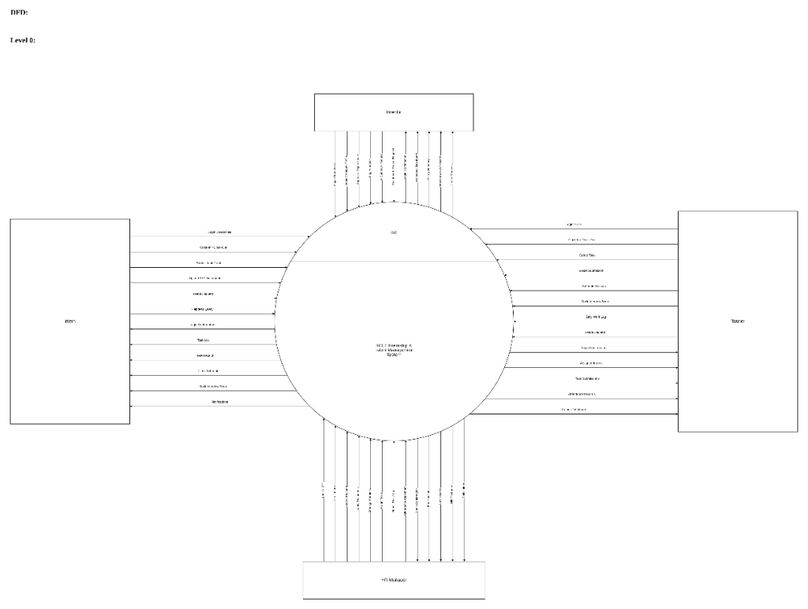
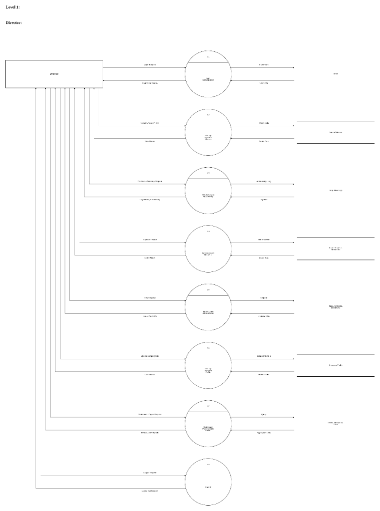
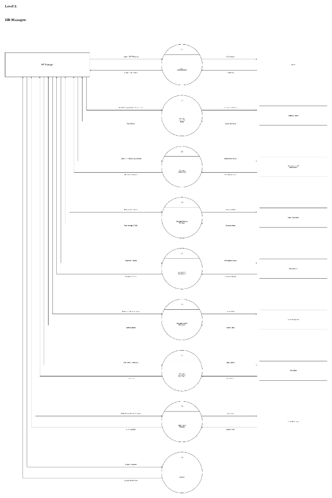
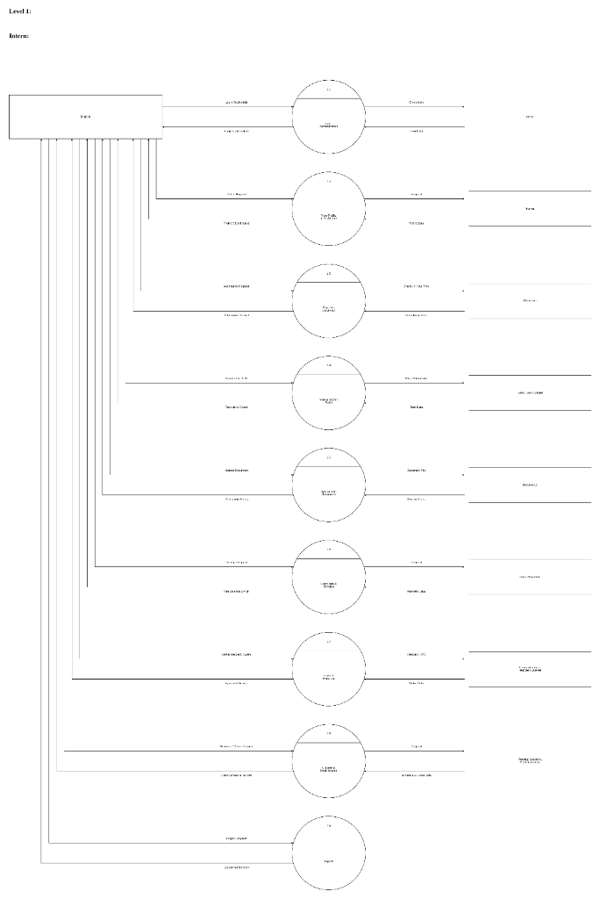

# MCA MAJOR PROJECT SYNOPSIS
## Project Title: Internship & Talent Management System (IMS)
### Developed for: IICET Services Private Limited

---

<!-- PAGE 1 -->
## 1. Introduction

The **Internship & Talent Management System (IMS)** is a comprehensive web-based platform developed to automate and simplify the internship onboarding, lifecycle tracking, attendance monitoring, task delegation, and evaluation process in technical training institutions and corporate academies. Developed for **IICET Services Private Limited**, the system provides separate, dedicated login and functional modules for the **Director (Executive Management)**, **HR Manager**, **Technical Trainers (Mentors)**, and **Interns (Students)**.

The Director oversees institutional metrics, financial audits, staff attendance, and executive AI work summaries. The HR Manager handles student onboarding, batch distribution, fee collection ledgers, leave management, and document KYC verification. Technical Trainers assign programming tasks, schedule curriculum sessions, and grade project submissions. Interns securely log in to record daily attendance, submit completed task proofs, track remaining fee balances, download branded PDF receipts, and access lecture schedules.

The application is developed using **React.js** for the frontend, **Express.js (Node.js)** for the backend REST API, and **SQLite / MySQL** as the relational database engine. The system integrates **Google Gemini 1.5 Flash AI** for automated weekly/monthly staff work log summarization and employs automated background cron jobs for daily attendance check-out.

The current internship management process in many training centers and colleges is partially manual or relies on multiple disconnected tools such as paper attendance sheets, Excel spreadsheets, and informal messaging channels. Student records, fee payment receipts, and project submissions are frequently lost or unorganized. This conventional approach is time-consuming, prone to human calculation errors, causes attendance disputes, and delays certification. Management also lacks unified visibility into daily institutional operations.

<div style="page-break-after: always;"></div>

---

<!-- PAGE 2 -->
## 1.1 Existing System

In many training institutes and colleges, internship operations, onboarding, and student tracking activities are still managed using manual processes or multiple disconnected systems. Mentors maintain task lists and marks in local spreadsheets or physical notebooks, making continuous performance evaluation difficult. HR executives record fee payments and attendance across separate registers, leading to data inconsistencies. Students must repeatedly visit administrative desks to request fee receipts, verify KYC documents, and track leave approvals. Such legacy systems often lead to:

- **Manual data entry**: Repetitive data entry across multiple ledgers and spreadsheets.
- **Time-consuming result preparation**: Manual calculation of attendance hours, eligibility, and grading.
- **Human errors in mark & fee calculations**: Discrepancies in installment balances and attendance tallies.
- **Difficulty in maintaining intern records**: Fragmented documentation across paper files and local hard drives.
- **Delayed performance evaluation**: Feedback bottlenecks and delayed certificate issuance.
- **Lack of centralized management**: Absence of a single unified portal for Director, HR, Trainers, and Students.
- **Document & KYC tracking bottlenecks**: Inability to quickly verify uploaded ID cards and offer letters.
- **Lack of automated executive intelligence**: No mechanism to synthesize daily staff achievements for management.

<div style="page-break-after: always;"></div>

---

<!-- PAGE 3 -->
## 1.2 Need and Scope of the New System

The proposed system eliminates manual paperwork and fragmented spreadsheets by providing a single, centralized, and automated internship management portal.

### Need
- To automate intern onboarding, lifecycle monitoring, and batch allocation.
- To eliminate manual errors in fee tracking, installment management, and receipt generation.
- To maintain centralized, normalized database records of interns, mentors, and staff.
- To automate daily attendance check-ins, check-outs, and late detection through cron schedulers.
- To provide secure, role-based authentication using JWT tokens and email OTP.
- To provide automated performance summarization using Google Gemini Generative AI.
- To enable students and staff to download official fee receipts and audit reports in PDF format.

### Scope
The system is designed for professional training organizations, corporate internship programs, and educational institutions offering technical certifications (such as MCA, BCA, and Engineering). It supports:
- **Centralized Role-Based Access Control**: Granular roles for Director, HR Manager, Technical Trainer, and Intern.
- **Intern Lifecycle & Batch Management**: Automated onboarding, cohort allotment, and status tracking.
- **Mentor / Team Lead Allocation**: Workload balancing and mentor performance scoring.
- **Multi-Role Attendance Management**: Geo/time check-in, late detection, and 6 PM cron auto-checkout.
- **Task Delegation & Submission Kanban**: Real-time assignment allocation, proof link submissions, and grading.
- **Daily Work Logs with AI Summaries**: Staff accountability with Google Gemini 1.5 Flash summarization.
- **Curriculum & Training Schedule**: Syllabus management and scheduled live class sessions with meeting links.
- **Double-Entry Fee Management**: Installment ledgers, balance computation, and instant branded PDF receipts.
- **KYC Document Repository**: Secure upload and administrative verification of identity proofs and certificates.
- **Leave Management & Attendance Sync**: Automatic conversion of approved leave days into attendance logs.
- **CRM Admissions Pipeline**: Tracking prospective student inquiries, follow-up calls, and enrollment stages.
- **Helpdesk Support Ticketing**: Category-based query resolution across administrative tiers.
- **Mock Interviews & Placement Assessment**: Structured technical scoring (0-10) and readiness evaluation.
- **Institutional CSV Data Exports**: Complete auditing sheets for rosters, attendance, and finance.

<div style="page-break-after: always;"></div>

---

<!-- PAGE 4 -->
## 2. Proposed System

### 2.1 Objective
The main objectives of the proposed system are:
- To develop a centralized, normalized web portal for end-to-end internship administration.
- To provide secure authentication for Director, HR, Trainer, and Intern using JWT and email OTP.
- To manage intern profiles, batch allocations, and mentor assignments efficiently.
- To enforce strict attendance tracking with automated late-arrival flags and scheduled cron checkout.
- To streamline project task allocation, work submission URLs, and mentor review workflows.
- To manage institutional fee collections, installment balances, and print verifiable PDF receipts.
- To leverage Google Gemini 1.5 Flash AI to generate concise executive summaries of staff work logs.
- To synchronize approved leaves automatically with daily attendance records without manual intervention.
- To provide a structured CRM system to manage admissions inquiries and candidate follow-ups.
- To improve operational accuracy, ensure 100% data auditability, and eliminate administrative paperwork.

<div style="page-break-after: always;"></div>

---

<!-- PAGE 5 -->
## 2.2 Hardware and Software Specification

### Hardware Requirements
- **Processor**: Intel Core i3 processor or higher (or AMD Ryzen equivalent)
- **RAM**: 8 GB RAM or above
- **Storage**: 256 GB SSD or higher
- **Network**: Stable Internet Connection (Broadband / Wi-Fi)
- **Display**: Standard Monitor with 1366 × 768 resolution or above

### Software Requirements
- **Operating System**: Windows 10 / Windows 11 / Linux
- **Programming Environment**: Node.js (v20.x or v22.x LTS)
- **Backend Runtime & Framework**: Express.js (Node.js REST API)
- **Frontend Library & Build Tool**: React.js (v19) with Vite
- **Database Management System**: SQLite (Native node:sqlite) / MySQL 8.x
- **Code Editor**: Visual Studio Code
- **Version Control**: Git & GitHub
- **API Testing Tool**: Postman / Thunder Client
- **Web Browser**: Google Chrome / Microsoft Edge

<div style="page-break-after: always;"></div>

---

<!-- PAGE 6 -->
## 2.3 Technology Used

### Frontend
- **React.js (v19)**: Component-driven Single Page Application architecture.
- **HTML5 & CSS3**: Modern UI with CSS variables, responsive sidebars, and card layouts.
- **JavaScript (ES6+)**: Asynchronous client-side state management and data formatting.
- **Recharts**: Interactive institutional data visualization charts (attendance %, fee collections).
- **jsPDF & jspdf-autotable**: Client-side institutional PDF receipt generator.
- **Lucide React**: Modern iconography system.

### Backend
- **Node.js**: Asynchronous event-driven server runtime environment.
- **Express.js**: RESTful API routing, middleware, and CORS configuration.
- **JSON Web Token (JWT) & bcryptjs**: Cryptographic token authorization and secure password hashing.
- **Multer**: Multipart form data file upload middleware for documents and images.
- **Nodemailer**: Automated OTP email delivery via SMTP.
- **Google Generative AI (Gemini 1.5 Flash)**: AI-powered daily work log summarizer.
- **Node-Cron**: Automated background attendance and checkout daemon.

### Database
- **SQLite (Embedded DatabaseSync)** / **MySQL 8.x**: Impeccably normalized 3rd Normal Form (3NF/BCNF) relational schema across 21 entities.

### Tools & Utilities
- **Visual Studio Code**: Integrated development environment.
- **Git & GitHub**: Version control and source code repository.
- **Postman**: API testing and endpoint debugging.
- **SQLite Inspector / MySQL Workbench**: Relational schema modeling and querying.

<div style="page-break-after: always;"></div>

---

<!-- PAGE 7 -->
## 2.4 Database Design

### ER Diagram:

> **[ Entity Relationship Diagram Placeholder ]**
> 
> *Relational Schema for IICET IMS engineered to 3NF/BCNF.*
> 
> *(This page is kept formatted for diagram insertion as requested)*

```
+---------------------------------------------------------------------------------------------------+
|                                                                                                   |
|                                                                                                   |
|                                    [ INSERT ER DIAGRAM HERE ]                                     |
|                                                                                                   |
|  Entities Included:                                                                               |
|  • users (Identity & RBAC)                     • mentors (Trainer Extension)                      |
|  • interns (Student Extension)                 • attendance (Daily Clock-In)                      |
|  • mentor_attendance (Trainer Clock-In)        • hr_attendance (HR Clock-In)                      |
|  • daily_work_logs (Staff Submissions)         • trainings (Curriculum Tracks)                    |
|  • training_sessions (Class Schedules)         • tasks (Kanban Tasks)                             |
|  • task_updates (Proof Submissions)            • fees (Tuition Balances)                          |
|  • payments (Installment Ledger)               • documents (KYC Attachments)                      |
|  • leave_requests (Time-off Records)           • enquiries (CRM Admissions)                       |
|  • helpdesk_queries (Support Tickets)          • mock_interviews (Evaluations)                    |
|  • company_profile (Singleton Master)          • notifications & activity_logs                    |
|                                                                                                   |
|                                                                                                   |
+---------------------------------------------------------------------------------------------------+
```

<div style="page-break-after: always;"></div>

---

<!-- PAGE 8 -->
## DFD:
### Level 0:



*Figure 2.1: Data Flow Diagram (DFD Level 0) Context Diagram for IICET Internship & Talent Management System*

<div style="page-break-after: always;"></div>

---

<!-- PAGE 9 -->
## Level 1:
### Director:



*Figure 2.2: Data Flow Diagram (DFD Level 1) for Director Module*

<div style="page-break-after: always;"></div>

---

<!-- PAGE 10 -->
## Level 1:
### HR Manager:



*Figure 2.3: Data Flow Diagram (DFD Level 1) for HR Manager Module*

<div style="page-break-after: always;"></div>

---

<!-- PAGE 11 -->
## Level 1:
### Intern:



*Figure 2.4: Data Flow Diagram (DFD Level 1) for Intern Module*

<div style="page-break-after: always;"></div>

---

<!-- PAGE 12 -->
## Level 1:
### Trainer / Faculty:

> **[ DFD Level 1: Trainer Placeholder ]**
> 
> *(This page is kept formatted for diagram insertion as requested)*

```
+---------------------------------------------------------------------------------------------------+
|                                                                                                   |
|                                                                                                   |
|                          [ INSERT DFD LEVEL 1: TRAINER / FACULTY HERE ]                           |
|                                                                                                   |
|  Functional Decomposition:                                                                        |
|  • 1.0 User Authentication & Auto Clock-In                                                        |
|  • 1.1 View Assigned Cohorts & Student Rosters                                                    |
|  • 1.2 Manage Tasks, Assign Deadlines & Grade Submissions                                         |
|  • 1.3 Conduct Curriculum Sessions & Class Scheduling                                             |
|  • 1.4 Conduct Mock Technical Interviews & Evaluate Readiness                                     |
|  • 1.5 Submit Daily Work Logs with Blocker Notes to Director                                      |
|  • 1.6 Session Invalidation & Logout                                                              |
|                                                                                                   |
|                                                                                                   |
+---------------------------------------------------------------------------------------------------+
```

<div style="page-break-after: always;"></div>

---

<!-- PAGE 13 -->
## Level 2:
### Director / Admin:

> **[ DFD Level 2: Director / Admin Placeholder ]**
> 
> *(This page is kept formatted for diagram insertion as requested)*

```
+---------------------------------------------------------------------------------------------------+
|                                                                                                   |
|                                                                                                   |
|                       [ INSERT DFD LEVEL 2: DIRECTOR / ADMIN PROCESSES HERE ]                     |
|                                                                                                   |
|  Sub-Processes:                                                                                   |
|  • 2.1 Validate Credentials & Verify JWT Signature                                                |
|  • 2.2 Retrieve Aggregated Institutional Analytics (Interns, Mentors, Attendance Rate)           |
|  • 2.3 Financial Audit & Fee Revenue Inspection                                                   |
|  • 2.4 Google Gemini 1.5 Flash AI Log Summarization Processing                                    |
|  • 2.5 Review & Approve Inter-Departmental Leave Applications                                     |
|  • 2.6 Institutional Master Branding & Settings Management                                        |
|                                                                                                   |
|                                                                                                   |
+---------------------------------------------------------------------------------------------------+
```

<div style="page-break-after: always;"></div>

---

<!-- PAGE 14 -->
## Level 2:
### HR Manager & Trainer Sub-Processes:

> **[ DFD Level 2: HR Manager & Trainer Placeholder ]**
> 
> *(This page is kept formatted for diagram insertion as requested)*

```
+---------------------------------------------------------------------------------------------------+
|                                                                                                   |
|                                                                                                   |
|                   [ INSERT DFD LEVEL 2: HR MANAGER & TRAINER SUB-PROCESSES HERE ]                 |
|                                                                                                   |
|  Sub-Processes:                                                                                   |
|  • 3.1 Student Onboarding, Profile Generation & Fee Ledger Initialization                         |
|  • 3.2 Payment Installment Recording, Balance Ledger Calculation & PDF Receipt Output            |
|  • 3.3 Document KYC Verification (Uploaded -> Approved / Rejected)                               |
|  • 3.4 Leave Approval & Bi-Directional Attendance Record Upsert                                   |
|  • 3.5 Task Evaluation, Proof Inspection & Score Grading                                          |
|  • 3.6 Mock Technical Interview Scheduling & Score Recording                                      |
|                                                                                                   |
|                                                                                                   |
+---------------------------------------------------------------------------------------------------+
```

<div style="page-break-after: always;"></div>

---

<!-- PAGE 15 -->
## 3. Working of Proposed System

The proposed **Internship & Talent Management System (IMS)** operates in the following sequential manner:

1. **Director Login & Institutional Oversight**: The Director logs into the portal using secure credentials to view real-time institutional KPIs, active student count, financial cash-flow totals, and staff attendance.
2. **Intern Onboarding & Batch Assignment**: The HR Manager logs in, onboards new candidates, creates their student profile, assigns them to a batch timing (e.g., 09:00 AM – 01:00 PM), assigns a technical mentor, and creates their program tuition ledger.
3. **Admissions CRM Pipeline**: The HR Manager records prospective student inquiries, logs phone follow-up records, and smoothly converts qualified candidates into active intern records.
4. **Trainer Presence & Roster Management**: Technical Trainers log in, triggering automatic daily clock-in timestamps, and view assigned batches and student rosters.
5. **Curriculum & Lecture Scheduling**: Trainers establish training tracks and schedule upcoming live sessions with Google Meet links, lecture dates, and syllabus reference links.
6. **Task Delegation & Priority Assignment**: Trainers assign hands-on programming tasks with priority flags (`Low`, `Medium`, `High`) and submission deadlines.
7. **Daily Intern Clock-In & Late Detection**: Interns log into their portal, clock in their daily attendance (automatically flagged `Late` if between 09:30 AM and 11:00 AM), and inspect their assignment checklist.
8. **Work Submission & Mentor Review**: Interns submit completed assignments with live GitHub or demo URLs; Trainers review submissions, award grades, provide constructive feedback, and mark tasks `Completed` or `Pending`.
9. **Technical Mock Evaluation**: Trainers conduct technical mock interviews and mock tests, recording quantitative scores (0.0 to 10.0 scale) and feedback for industrial placement readiness.
10. **Daily Staff Work Logs**: Trainers and HR executives submit daily work logs to the Director detailing hours worked, achievements, and blockers.
11. **AI Performance Summarization**: The Director uses the integrated **Google Gemini 1.5 Flash AI** engine to synthesize multi-day work logs into concise executive bullet points.
12. **Fee Installments & PDF Receipt Printing**: HR records installment payments against tuition balances; the system updates remaining amounts and instantly generates a branded, official PDF receipt with signature lines.
13. **Leave Requests & Bi-Directional Sync**: Interns and staff file leave requests; upon approval by HR/Director, the system automatically marks each day in the date range as `Leave` in the attendance ledger.
14. **Automated Background Cron Daemon**: At 5:00 PM every day, a background cron auto-marks unclocked students and staff as `Absent`; at 6:00 PM, an auto-checkout interval closes open sessions and logs 8.0 working hours.
15. **Institutional Auditing & Database Inspection**: The Director and HR download CSV reports for attendance, rosters, and fee balances, and administrators inspect raw tables using the embedded `/db-viewer` interface.

<div style="page-break-after: always;"></div>

---

<!-- PAGE 16 -->
## 4. Advantages

- **End-to-End Automation**: Automates onboarding, daily attendance, task reviews, and certification workflows.
- **Elimination of Paperwork & Spreadsheets**: Consolidates all data into a 3NF normalized relational database.
- **Attendance Accountability**: Precise clock-in timestamps, automated late detection, and cron auto-checkout.
- **Strict Role-Based Security**: Complete data isolation and operational clarity across Director, HR, Trainer, and Intern.
- **Transparent Task & Project Grading**: Structured submission proof links with mentor feedback logs.
- **Zero Financial Discrepancies**: Automatic computation of total, paid, and remaining fee balances with instant PDF receipts.
- **Generative AI Executive Intelligence**: Google Gemini 1.5 Flash eliminates manual reading of lengthy daily logs.
- **Bi-Directional Leave Synchronization**: Eliminates attendance disputes by automatically converting approved leaves into attendance records.
- **Centralized KYC Document Storage**: Prevents lost records with status-driven document approvals.
- **Comprehensive CRM Lead Tracking**: Accelerates student admissions and tracks candidate conversion rates.
- **Institutional Compliance**: One-click generation of CSV audit reports for academic and institutional reviews.
- **High Scalability & Performance**: Optimized Express REST API and lightweight React 19 frontend.

<div style="page-break-after: always;"></div>

---

<!-- PAGE 17 -->
## 5. Future Scope

The proposed system can be enhanced by incorporating:
- **Native Android & iOS Mobile Application**: Mobile clock-in with geo-fencing and instant push notifications.
- **Biometric & RFID Attendance Integration**: Hardware turnstile integration for physical fingerprint and RFID card scans.
- **AI-Powered Code Review**: Automated syntax, security, and plagiarism analysis on intern GitHub repositories.
- **Direct Online Payment Gateway**: Integration with Razorpay, Stripe, and UPI QR codes for seamless fee payments.
- **Facial Recognition Attendance**: Webcam-based AI facial verification to eliminate proxy attendance.
- **Automated Stipend & Payroll Engine**: Direct stipend calculation based on recorded attendance hours.
- **Placement Corporate Portal**: Dedicated hiring partner portal allowing recruiters to browse top-rated certified interns.
- **SMS & WhatsApp Messaging Gateway**: Automated SMS notifications for fee receipts, session reminders, and alerts.
- **Cloud Deployment**: Containerization with Docker and automated deployment on AWS / Google Cloud Platform.

<div style="page-break-after: always;"></div>

---

<!-- PAGE 18 -->
## 6. Conclusion

The **Internship & Talent Management System (IMS)** provides a secure, reliable, and highly efficient institutional platform for managing technical training cohorts, intern ongoings, attendance records, task evaluations, and financial fee transactions. It automates repetitive administrative procedures, eliminates human error in fee calculations, enforces punctuality through automated attendance daemons, and delivers real-time visibility to executive leadership.

By integrating modern web technologies (React.js, Node.js, and Express) with an impeccably normalized 3NF relational data model and state-of-the-art Google Gemini 1.5 Flash Generative AI, the platform bridges the gap between students, instructors, and administration. The system ensures complete transparency, generates verifiable digital PDF receipts, streamlines KYC compliance, and accelerates institutional workflows. Its modular and extensible architecture ensures it can readily scale to meet the evolving operational requirements of higher educational institutions and industrial training academies.

<div style="page-break-after: always;"></div>

---

<!-- PAGE 19 -->
## 7. References

1. **React.js Documentation** – [https://react.dev/](https://react.dev/)
2. **Node.js Official Documentation** – [https://nodejs.org/docs/](https://nodejs.org/docs/)
3. **Express.js Application Framework** – [https://expressjs.com/](https://expressjs.com/)
4. **SQLite Native Documentation** – [https://www.sqlite.org/docs.html](https://www.sqlite.org/docs.html)
5. **MySQL 8.0 Reference Manual** – [https://dev.mysql.com/doc/refman/8.0/en/](https://dev.mysql.com/doc/refman/8.0/en/)
6. **Google Gemini AI SDK Documentation** – [https://ai.google.dev/docs](https://ai.google.dev/docs)
7. **JSON Web Token (JWT) Standard** – [https://jwt.io/introduction/](https://jwt.io/introduction/)
8. **jsPDF Client-side Documentation** – [https://github.com/parallax/jsPDF](https://github.com/parallax/jsPDF)
9. **Git Version Control System** – [https://git-scm.com/doc](https://git-scm.com/doc)

---
*Document prepared for MCA Major Project Submission — IICET Services Private Limited © 2026.*
